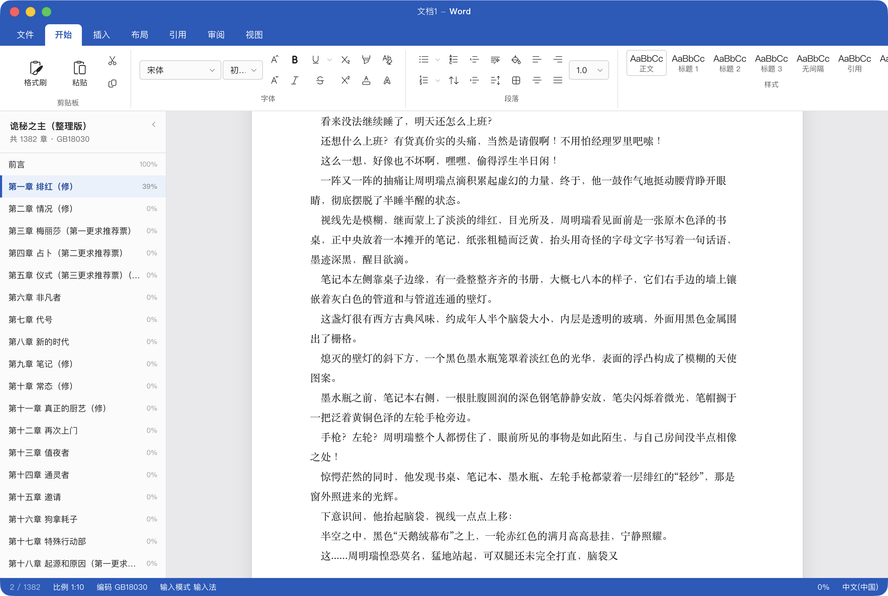

[English](README.md) | **简体中文**

# WorkingTitle

**把阅读藏进一个长得像 Microsoft Word 的窗口里。**

导入一篇 txt 小说，然后像写文档一样打字——你敲的字符不会显示，取而代之的是小说正文按顺序落到
纸上。屏幕上看起来就是一个 Word 窗口：蓝色标题条、功能区七个选项卡、白色 A4 纸、底部状态栏。



> **关于「伪装」**
>
> 界面刻意模仿 Microsoft Word 的外观，目的是在办公环境里不引人注意。
> **这不是微软的产品，与微软无关，也不应当作微软产品分发。** 应用自己的名称、图标与打包标识
> 都是 WorkingTitle，没有使用任何微软的商标或图标资源——界面用的是
> [`@fluentui/react-icons`](https://github.com/microsoft/fluentui-system-icons)（MIT 许可的公开图标集）。

## 安装

从 [Releases](https://github.com/chenyie7/WorkingTitle/releases) 下载：

| 平台 | 下载 |
|---|---|
| Windows | `WorkingTitle-v<版本>-win-x64.exe`（安装器）或 `WorkingTitle-v<版本>-win-x64.zip`（免安装） |
| macOS | `WorkingTitle-v<版本>-mac-arm64.dmg`（Apple 芯片）或 `WorkingTitle-v<版本>-mac-x64.dmg`（Intel） |

Windows 的 **zip 版解压即用**——不跑安装器、不写注册表、不需要管理员权限。

macOS 用 dmg 就行：挂载后把 `WorkingTitle.app` 拖进「应用程序」。**dmg 本身不安装任何东西**，
所以它已经满足了「不想跑安装器」这个诉求。

### 首次打开会被系统拦一下

本应用**没有代码签名**（证书要花钱），所以：

- **Windows**：SmartScreen 警告 →「更多信息」→「仍要运行」
- **macOS**：Gatekeeper 拦下 → 右键点图标选「打开」；或
  `xattr -dr com.apple.quarantine /Applications/WorkingTitle.app`

## 使用

1. **导入小说** —— `⌘/Ctrl + ,` 打开设置 →「导入小说」。导入时会拷贝一份到应用的数据目录，
   原文件删掉也不影响阅读；设置里的「小说管理」可以查看书库、切换和删除。也可以在启动时直接
   把 txt 路径当命令行参数。
2. **打字** —— 在文档区敲任何键，正文按比例出现。默认 1 次击键 10 个字，范围 1–500。
3. **跳章** —— 左侧点任意一章；`⌘/Ctrl + Shift + H` 收起整条左栏。两条快捷键都可以改，见[快捷键](#快捷键)。
4. **调外观** —— 设置里可选跟随系统 / 浅色 / 深色。深色下纸张默认仍是白的（跟真 Word 一样），
   想让纸也变暗可以勾上。
5. **分章不对时** —— 打开设置 →「分章设置」，选一条预置规则或自己写正则，点「应用」。
   规则按书记住；正文与阅读进度都不动。

设置会跨重启保存，**阅读进度按书各留一份**——导入第二本不会丢掉第一本读到哪。

书库里的每本书都可以单独删除，删除会同时删掉拷贝件与这本书的阅读进度。
「清除阅读记录」只重置当前打开的那本书，书仍留在书库里。

### 两种输入模式

| 模式 | 行为 | 适合 |
|---|---|---|
| **输入法友好**（默认） | 中文输入法打拼音，上屏几个字就抽几个字；拼音过程不抽字 | 平常用 |
| **纯按键** | 敲一个键抽一次，绕过输入法 | 键盘盲打 |

### 快捷键

三条快捷键可以改，两个平台的默认值各自不同：

| 动作 | macOS | Windows / Linux |
|---|---|---|
| 导入小说 | `⌘O` | `Ctrl+O` |
| 显示/隐藏章节栏 | `⇧⌘H` | `Ctrl+Shift+H` |
| 打开设置 | `⌘,` | `Ctrl+,` |

进设置 → **快捷键**，点一下输入框、直接按下想用的组合键。`Esc` 取消这次录制、值不变；
`↺` 恢复该平台的默认值。**点「保存」才生效**，macOS 上顶部菜单里那一项也会跟着变。

组合键必须至少带一个修饰键——裸按键会被当作打字吃掉、到不了页面。macOS 上有一批组合键会被
拒绝，因为系统或本应用自己的菜单已经占用了它们（`⌘Q`、`⌘W`、`⌘C` 等）。

## 从源码构建

需要 Node ≥ 22.12、pnpm 11。

```bash
pnpm install
pnpm dev
```

| 命令 | 作用 |
|---|---|
| `pnpm dev` | 开发模式（渲染层热更新） |
| `pnpm build` | 构建到 `out/` |
| `pnpm typecheck` | 类型检查（跑两个 tsconfig） |
| `pnpm test` | 单元测试 |
| `pnpm test:e2e` | 端到端测试（起真实 Electron 进程） |
| `pnpm dist:mac` | 打包成两个 `.dmg`（arm64 + x64） |
| `pnpm dist:win` | 打包成 `.exe` 安装器与免安装 `.zip` |

`out/` 不在 git 里：**手动启动 Electron 之前先 `pnpm build`**，否则跑的是上一次的产物，
而 `git status` 完全看不出来。

打 Windows 包建议走 CI——在 macOS 上打 Windows 包需要 wine。推一个 `v*` 标签，CI 会在两个平台上
各自原生构建，并把安装包挂到该标签对应的 GitHub Release 上；手动触发工作流则只构建，
产物在 Actions 的 Artifacts 里。

## 已知限制

- **应用内除了文档区，其余都是外观占位**。功能区那七个选项卡里约 150 个按钮，点了只弹一句
  「演示占位功能，未实现」；真正有功能的只有设置对话框里那几项。
- **输入法行为只有真机说了算**。候选框由系统绘制、不在页面里，自动化测不到它的位置。
- **录制快捷键时，macOS 的原生菜单加速键仍然会触发。** 录制框只静音了应用自己的快捷键分发器，
  静音不了系统菜单栏——录制中按下 `⌘O` 会弹出文件选择框。取消掉重新录即可。
- **文档名与两个阅读替换比例要点「保存」才生效**，不是边打边生效。外观、纸张、输入模式是立即生效的。

## 技术栈

Electron 44 · electron-vite 5 · Vite 7 · React 19 · TypeScript 5.9 · Vitest 5 ·
Playwright 1.63 · electron-builder 26 · jschardet 4 · iconv-lite 0.7 · @fluentui/react-icons 2

更细的架构与约定——`src/core` 的纯净性是怎么被构建配置强制的、输入捕获那几个坑、
实现计划与源码的逐字节同步口径——见 [CLAUDE.md](CLAUDE.md)。

## 许可

[MIT](LICENSE)
